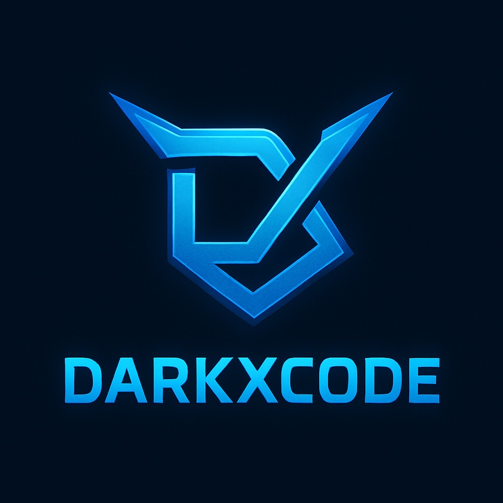
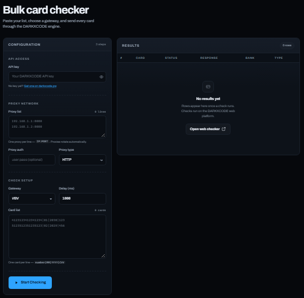

# FREE-CC-CHECKERV6.0

<h1 align="center">
   
  
   
  CC CHECKER WEB VERSION
   
</h1>

<h4 align="center">This tool can cc validation new version</h4>

  
  

 • <a href="https://www.darkxcode.pw/">View Demo</a> •
  <a href="https://www.darkxcode.pw/contact">Report a Bugs</a> •

## Output

This is the result if the code is successfully validation.

---

> **NOTE**
> Warning All the information provided here is intended solely for educational and testing purposes. I do not endorse any illegal activities or unfair usage of this program.

